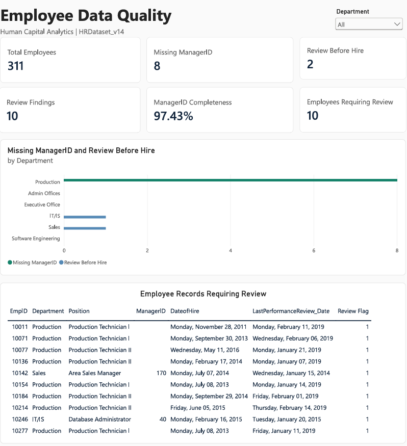
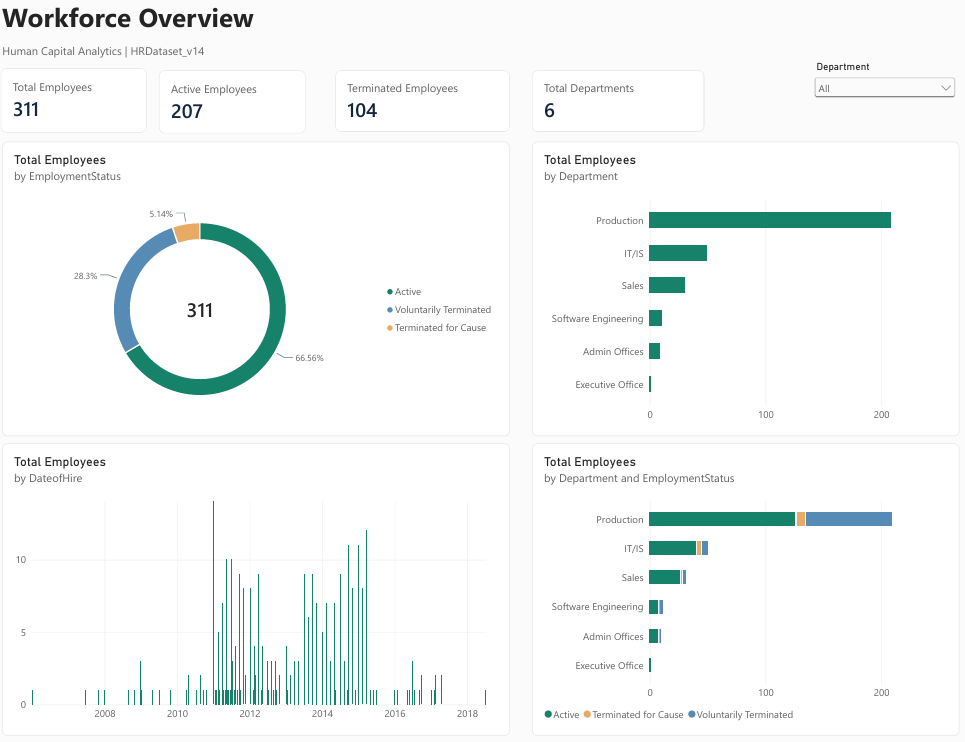
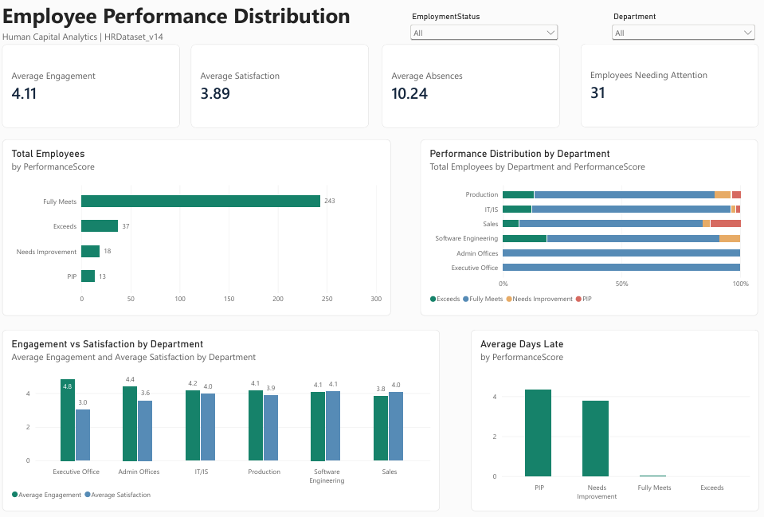

# Employee Data Quality & Human Capital Analytics

**Python · Pandas · SQL (SQLite) · Power BI**  
**Project type:** Personal data analytics portfolio | **Dataset:** Synthetic HR records

## Overview

This project explores employee data quality, workforce composition, performance, engagement, satisfaction, and attendance using the publicly available **Human Resources Data Set (HRDataset_v14)**. The workflow covers data understanding, cleaning and validation, exploratory data analysis (EDA), SQL analysis, and a three-page Power BI report.

The aim is to show how data validation and analysis can support human capital reporting. The dataset represents a fictional organization, so the findings are illustrative rather than insights about a real employer.

## Dataset

- **Source:** [Human Resources Data Set — Kaggle](https://www.kaggle.com/datasets/rhuebner/human-resources-data-set)
- **Creators:** Dr. Rich Huebner and Dr. Carla Patalano
- **Codebook:** [HR Dataset v14](https://rpubs.com/rhuebner/hrd_cb_v14)
- **Size:** 311 employee records, 36 original attributes
- **Hiring dates represented:** 2006–2018
- **License:** CC BY-NC-ND 4.0 (as specified by the dataset authors)

**The original and modified CSV files are not redistributed in this repository.** Download the dataset directly from Kaggle to reproduce the analysis. The published notebooks should contain code and aggregate outputs only; inspect notebook outputs before uploading them.

## Project workflow

1. **Data understanding:** inspect schema, types, missing values, duplicates, and initial consistency rules.
2. **Cleaning and validation:** standardize text/date formats, check HR business rules, preserve unresolved values, and document possible date-of-birth century corrections.
3. **Exploratory data analysis:** study workforce distribution, recruitment timing, employment status, performance, engagement, satisfaction, and attendance.
4. **SQL analysis:** load cleaned records into SQLite and perform aggregation and consistency queries.
5. **Power BI report:** create an interactive, three-page dashboard with KPI cards, charts, and departmental filters.

No training or document-inventory dataset was fabricated or appended to the source data.

## Selected results

| Metric | Result |
|---|---:|
| Unique employee records | 311 |
| Original attributes retained | 36 |
| Not terminated | 207 |
| Terminated | 104 |
| Departments | 6 |
| Missing ManagerID values requiring review | 8 |
| Performance review dates before hire dates | 2 |
| Total review findings across those two checks | 10 |
| Duplicate employee IDs | 0 |
| Average engagement (Python EDA) | 4.11 |
| Average employee satisfaction (Python EDA) | 3.89 |

**Notes:** Ten review *findings* do not necessarily mean ten unique employees. The initial validation rules returned zero errors, but unresolved review findings remain. One hundred DOB century adjustments were logged as rule-based corrections and should not be interpreted as independently verified dates of birth.

## Dashboard pages

### 1. Employee Data Quality
KPI cards, missing manager IDs, performance-review chronology checks, issue distribution by department, and a record-review table.

<!-- After uploading a screenshot, uncomment the line below. Blur/omit individual-level data if necessary. -->
<!--  -->

### 2. Workforce Overview
Active versus terminated records, department composition, and hire-year patterns.

<!--  -->

### 3. Employee Performance & Attendance
Performance categories, average engagement and satisfaction, absences, and days late.

<!--  -->

## Selected exploratory findings

- Production accounts for **209 of 311 records (67.2%)**, and **83 of 104 recorded terminations**.
- **243 employees (78.1%)** have a performance rating of *Fully Meets*; **37 (11.9%)** are rated *Exceeds*.
- The average number of days late in the last 30 days differs by performance category: **PIP 4.31**, **Needs Improvement 3.78**, **Fully Meets 0.02**, and **Exceeds 0.00**.
- These are descriptive observations; they do not establish causal relationships.

## Repository layout

```text
notebooks/
  01_data_understanding_and_cleaning.ipynb
  02_exploratory_data_analysis.ipynb
  03_sql_data_analysis.ipynb
assets/
  01_employee_data_quality.png
  02_workforce_overview.png
  03_performance_attendance.png
powerbi/
  HC_Analytics_PowerBI_Theme.json
README.md
requirements.txt
.gitignore
```

Notebook and screenshot files listed above are added separately after exporting them from Colab and Power BI.

## How to reproduce

1. Download `HRDataset_v14.csv` from the linked Kaggle page.
2. Open the notebooks using Google Colab, starting with data understanding and cleaning.
3. Upload the CSV when prompted by the notebook; run the cells in order.
4. Use the cleaned output to run the EDA and SQL notebooks.
5. Load the cleaned file into Power BI Desktop and recreate the report using the documented measures and visual specifications.

**Before publishing screenshots**, verify that the Power BI decimal conversion is correct: the overall mean of `EngagementSurvey` should be approximately **4.11**, not a value above the survey scale. Check the report with slicers cleared.

## Limitations

- The data are **synthetic**, not actual records from Pegadaian, BPK Kupang, or any organization.
- Hiring dates end in 2018; the report is not a view of today's workforce.
- Missing termination dates for non-terminated employees are expected, not automatically invalid.
- Missing manager IDs and chronology anomalies remain review findings rather than invented corrections.
- Descriptive correlations must not be interpreted as causal effects.

## Data attribution & usage

Data authored by **Dr. Rich Huebner and Dr. Carla Patalano**, sourced from [Kaggle](https://www.kaggle.com/datasets/rhuebner/human-resources-data-set). The authors specify **Creative Commons Attribution–NonCommercial–NoDerivatives 4.0** for sharing the dataset. This repository intentionally does not republish original or modified dataset files. Refer to the source's license and permissions before distributing any dataset-derived artifacts.
